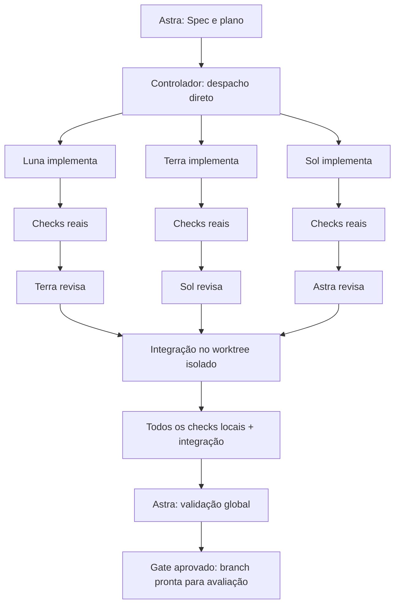

# Codex Orchestrator

**Skill, hooks e controlador local para implementar com Luna/Terra/Sol, revisar no nível seguinte e validar o conjunto com Astra.**

O encaminhamento é código Python, não uma conversa entre quatro modelos. Uma tarefa simples vai diretamente ao Luna. Terra revisa essa tarefa; Sol não é chamado apenas para repassá-la. Astra recebe a entrega integrada, não os históricos completos dos executores.

> **Estado:** versão inicial `0.1.0`. Os testes automatizados usam um CLI simulado com subprocessos reais, Git, worktrees, checks e persistência. Isso não equivale a um teste com os modelos reais. O uso real exige Codex instalado/autenticado e acesso aos modelos configurados. Nenhuma equivalência de qualidade ou porcentagem de economia é prometida.

## Índice

- [Arquitetura](#arquitetura)
- [Instalação](#instalação)
- [Configuração dos modelos e testes](#configuração-dos-modelos-e-testes)
- [Uso pela skill](#uso-pela-skill)
- [Contrato do plano](#contrato-do-plano)
- [Fluxos completos](#fluxos-completos)
- [Hooks: o que fazem e o que não fazem](#hooks-o-que-fazem-e-o-que-não-fazem)
- [Estado, retomada e evidências](#estado-retomada-e-evidências)
- [Tokens e eficiência](#tokens-e-eficiência)
- [Demonstração e testes](#demonstração-e-testes)
- [Limites e compatibilidade](#limites-e-compatibilidade)
- [Estrutura e referências](#estrutura-e-referências)

## Arquitetura

| Responsabilidade | Componente |
|---|---|
| Investigar requisitos, planejar e classificar tarefas | Astra, na sessão principal com a skill |
| Resolver dependências, despachar, limitar tentativas e salvar estado | Controlador Python determinístico |
| Implementar uma tarefa simples | Luna |
| Revisar a implementação do Luna | Terra, em uma nova invocação |
| Implementar uma tarefa intermediária | Terra |
| Revisar a implementação do Terra | Sol, em uma nova invocação |
| Implementar uma tarefa complexa | Sol |
| Revisar a implementação do Sol | Astra, em uma nova invocação |
| Validar integração, comportamento global e critérios finais | Astra, após os checks consolidados |



A hierarquia é uma **política de responsabilidades**, não um benchmark de capacidade universal dos modelos. A versão inicial executa tarefas sequencialmente em uma worktree por run: não há escritores concorrentes no mesmo checkout.

### Por que usar `codex exec`, se existem subagentes nativos?

Porque a transição `implementação -> testes -> revisor correto` precisa ser determinística e não depender de uma nova decisão do Astra. O controlador inicia sessões independentes de `codex exec`, configura modelo/esforço explicitamente, solicita saída estruturada e aplica os gates.

Os perfis nativos instalados em `.codex/agents/` são auxiliares para uso manual. **Invocar um desses subagentes manualmente não cria uma aprovação no controlador.** O fluxo gerenciado usa `run`; não mistura execuções próprias com threads nativas.

## Instalação

### Requisitos

Python **3.11+**, Git, Codex CLI instalado e autenticado, acesso aos modelos desejados e um projeto Git com ao menos um commit. Linux, macOS e WSL são os ambientes-alvo. A instalação nativa no Windows é recusada nesta versão; use WSL.

O pacote não possui dependências Python de runtime. A instalação via `pip` utiliza setuptools para construir o pacote. As chamadas ao Codex continuam sujeitas ao plano/credenciais e às políticas da sua conta.

```bash
# Uma vez: instale o pacote em um ambiente Python persistente.
python3 -m venv ~/.venvs/codex-orchestrator
source ~/.venvs/codex-orchestrator/bin/activate
python -m pip install "git+https://github.com/A1b3rt0M3rcad0/codex-orchestrator.git"

# Instale a skill, os perfis auxiliares e os hooks no projeto consumidor.
codex-orchestrator --repo /caminho/do/projeto install
```

O instalador adiciona:

```text
seu-projeto/
├── .agents/skills/codex-orchestrator/
│   ├── SKILL.md
│   └── references/workflow.md
├── .codex/
│   ├── agents/co-*.toml
│   ├── config.toml                 # acrescenta um perfil; preserva o padrão existente
│   ├── hooks.json                 # preserva os outros hooks
│   └── orchestrator-install.json
├── AGENTS.md                      # acrescenta um bloco delimitado
└── orchestrator.toml              # configuração autoritativa do controlador
```

Não substitui as regras já existentes no `AGENTS.md`, não troca o modelo padrão do seu Codex e não grava credenciais. Reinstalar é idempotente. Arquivos de skill/agentes modificados manualmente são preservados por recusa explícita de sobrescrita.

O comando dos hooks contém o caminho absoluto do Python usado na instalação. Não apague/mova esse ambiente; reinstale no projeto ao mudar de ambiente Python.

**Instalar somente o `SKILL.md` não basta:** a skill chama o controlador, que precisa estar instalado. Os hooks também precisam de instalação e confiança locais.

## Configuração dos modelos e testes

### Modelos

Os nomes Astra, Sol, Terra e Luna representam os papéis. Os IDs padrão, conferidos na documentação oficial em **04/11/2026**, são:

| Papel | Model ID | Implementação | Revisão |
|---|---|---|---|
| Astra | `gpt-6-astra` | planejamento no perfil `max` | `max` |
| Sol | `gpt-6.1-sol` | `low` | `high` |
| Terra | `gpt-6.1-terra` | `medium` | `high` |
| Luna | `gpt-6-luna` | `max` | não revisa |

Luna foi mantido em `max` para reproduzir a configuração discutida. Isso **não** significa que `max` seja necessário para tarefas mecânicas. Ajuste e meça. `Ultra` e `Light` não são valores gravados literalmente na configuração.

Exemplo de ajuste em `orchestrator.toml`:

```toml
[models.luna]
model = "gpt-6-luna"
effort = "low"
review_effort = "max"
```

O runtime sempre usa `orchestrator.toml`. Os perfis nativos auxiliares são exemplos estáticos gerados na instalação; alterá-los não muda o runtime. Não há fallback silencioso para outro modelo quando um ID não está disponível.

### Checks reais: etapa obrigatória

O instalador **não** inventa um comando que sempre passe. Configure testes apropriados ao seu projeto:

```toml
[checks]
unit = ["{python}", "-m", "unittest", "discover", "-s", "tests", "-v"]
# Exemplos alternativos, conforme o projeto:
# unit = ["go", "test", "./..."]
# typecheck = ["npm", "run", "typecheck"]
# integration = ["npm", "run", "test:integration"]
```

Cada comando é um **array de argumentos**, executado sem shell. `{python}` usa o interpretador do controlador. Dependências, serviços e arquivos de ambiente precisam existir na worktree ou estar acessíveis pelo ambiente de execução; não são copiados/instalados automaticamente.

Checks devem ser não mutantes. Use `ruff check`, não correções automáticas; `prettier --check`, não `--write`. Código alterado por um check invalida a evidência.

```bash
cd /caminho/do/projeto
codex-orchestrator doctor
codex --profile codex-orchestrator
```

Na sessão do Codex, abra **`/hooks`**, revise e confie nos hooks do projeto. O instalador não concede confiança por você nem usa flags de bypass. O `doctor` verifica configuração e flags locais, mas não faz inferência e não comprova autenticação, confiança dos hooks ou disponibilidade dos modelos.

Ao iniciar o controlador de dentro do Codex, autorize o comando conforme a política local: ele precisa criar branches/worktrees e escrever metadados Git e artefatos. Ele não contorna a sandbox da sessão principal. Em um terminal normal, valem as permissões do usuário.

Commit as alterações de configuração e o plano antes de iniciar uma execução. O controlador recusa um checkout original com alterações não commitadas; nunca faz commit de trabalho pré-existente do usuário.

## Uso pela skill

Na sessão principal do Codex:

```text
$codex-orchestrator
Implemente [objetivo]. Estude AGENTS.md e o código relevante, defina o plano,
use Luna/Terra/Sol conforme a complexidade, execute os checks reais e as revisões
hierárquicas e entregue a branch somente após a validação global do Astra.
```

A skill orienta o Astra a criar o plano, validá-lo e executar o controlador. Quando o hook `SessionStart` fornecer o ID da sessão, ele deve ser passado em `--session-id`; assim o hook de conclusão acompanha somente essa conversa.

Também é possível usar o CLI diretamente, sem sessão interativa:

```bash
codex-orchestrator validate path/to/plan.json
codex-orchestrator run path/to/plan.json
codex-orchestrator list
codex-orchestrator status RUN_ID
codex-orchestrator gate RUN_ID
```

Sem `--session-id`, os gates do controlador continuam ativos; apenas não há vínculo com o `Stop` de uma conversa.

## Contrato do plano

```json
{
  "version": 1,
  "objective": "Implementar o comportamento solicitado",
  "acceptance": ["O comportamento integrado atende à especificação"],
  "integration_checks": ["unit"],
  "tasks": [
    {
      "id": "T1",
      "tier": "luna",
      "objective": "Implementar uma alteração delimitada",
      "scope": ["src/component.py", "tests/test_component.py"],
      "acceptance": ["O componente satisfaz um comportamento verificável"],
      "checks": ["unit"],
      "depends_on": []
    }
  ]
}
```

Use arquivos exatos ou diretórios terminados em `/`. Não são aceitos globs, caminhos absolutos, `..`, IDs duplicados ou dependências circulares. `.git`, `.codex`, `.agents` e `orchestrator.toml` não podem ser modificados por tarefas gerenciadas.

Os critérios devem descrever **comportamento observável**, não “código bom” ou “tarefa concluída”. O revisor precisa responder a todos os critérios, e testes reprovados não podem ser convertidos em sucesso por uma resposta do modelo.

## Fluxos completos

### Luna: implementação simples

```text
Astra define a tarefa
  -> controlador despacha diretamente ao Luna
  -> Luna implementa
  -> controlador executa os checks
       falha: Luna corrige, sem chamar revisor
  -> Terra revisa em contexto independente
       reprova: Luna corrige e repete os checks
       aprova: checkpoint local + evidências
  -> quando todas as tarefas terminam: checks consolidados + Astra global
```

### Terra: implementação intermediária

```text
Astra define a tarefa -> Terra implementa -> checks -> Sol revisa
                                            ^          |
                                            |-- correção
  -> checkpoint -> integração -> Astra global
```

Terra pode, antes de editar, propor subtarefas Luna dentro do seu escopo. O controlador executa cada filho e chama Terra para revisá-lo. Depois Terra recebe as provas e implementa a integração; Sol revisa essa integração e as alterações pertinentes. Não é necessário acionar Astra para encaminhar filhos.

### Sol: implementação complexa

```text
Astra define a tarefa -> Sol implementa -> checks -> Astra revisa localmente
                                          ^               |
                                          |--- correção ---|
  -> checkpoint -> integração -> Astra global
```

Sol pode propor Terra ou Luna diretamente. Uma subtarefa Terra também pode propor Luna. Cada pai pode delegar uma vez, antes de editar, sempre para um nível inferior e com escopo contido. O contexto transmitido é contrato + referências de provas, não o histórico de conversas.

As duas atuações de Astra no fluxo Sol têm escopos diferentes: **revisão local** e **validação sistêmica**. Não são duas releituras obrigatórias do mesmo diff.

### Escalonamento e correção global

Após o limite de tentativas: `Luna -> Terra`, com Sol revisando; `Terra -> Sol`, com Astra revisando. O patch existente é preservado para diagnóstico/correção. Sol esgotando as tentativas bloqueia para replanejamento; Astra não implementa e aprova a própria alteração.

Achados globais que apontem tarefas existentes geram tarefas de reparo delimitadas, com seus próprios checks e revisão. O conjunto é testado novamente. Achados que exigem novo escopo ou uma mudança global param para replanejamento. Nenhuma correção é iniciada se já não houver rodada final disponível para validá-la.

## Hooks: o que fazem e o que não fazem

| Hook instalado | Função |
|---|---|
| `SessionStart` | Fornece ID da sessão e instrução curta de vínculo com a execução |
| `Stop` | Consulta a run vinculada, verifica conclusão válida e evita afirmação de sucesso com evidência obsoleta |

O `Stop` pode solicitar **uma** continuação quando a run ainda está pendente. `stop_hook_active` impede loops. Uma run bloqueada/interrompida pode ser reportada como bloqueada; o hook não força tentativas infinitas. As invocações gerenciadas não ficam esperando a aprovação global para poder encerrar: o próprio controlador verifica cada fase.

**Não há launcher de revisão em `SubagentStop`.** O runtime usa processos `codex exec`, não threads criadas por `spawn_agent`. Misturar esses dois ciclos seria um erro. Os hooks não chamam modelos, não leem transcrições e não decidem o revisor.

Hooks precisam ser confiados, podem ser desativados por políticas locais e não constituem uma fronteira de segurança completa. Os gates de testes/revisão/estado são aplicados pelo controlador mesmo sem os hooks. Para regras organizacionais de merge, mantenha também a CI e as aprovações externas do seu projeto.

## Estado, retomada e evidências

Cada run cria a branch `orchestrator/RUN_ID` e uma worktree isolada. O checkout original não é modificado. A worktree fica, por padrão, em `../.codex-orchestrator-worktrees/REPO_ID/RUN_ID`, fora do projeto e de `.git`; esse local precisa ser gravável. É possível definir `runtime.worktree_root` para outro diretório externo. Estado e artefatos ficam em:

```text
<GIT_COMMON_DIR>/codex-orchestrator/
├── controller.lock
├── sessions/
└── runs/RUN_ID/
    ├── state.json
    ├── calls/0001-T1-implement/
    │   ├── request.json
    │   ├── schema.json
    │   ├── response.json
    │   ├── events.jsonl
    │   └── stderr.log
    └── checks/.../
        ├── evidence.json
        └── *.log
```

O estado é gravado por substituição atômica. Um lock do sistema operacional evita controladores concorrentes no mesmo repositório e é liberado automaticamente quando o processo termina.

```bash
codex-orchestrator list
codex-orchestrator status RUN_ID
codex-orchestrator resume RUN_ID
codex-orchestrator gate RUN_ID
```

`resume` conserva orçamento, resultados e aprovações. Uma falha de serviço durante a revisão retoma a revisão, não reimplementa uma tarefa já testada. Uma implementação interrompida é retomada como uma nova tentativa que precisa inspecionar o diff parcial. Alterações externas na worktree interrompem a retomada automática.

Revisões são vinculadas ao fingerprint do código e às evidências dos checks. Uma edição depois da aprovação invalida o `gate`. Revisores usam sandbox `read-only`, e o controlador também detecta alterações feitas durante revisão.

Checkpoints têm autor explícito **Codex Orchestrator**, não se passam pelo usuário e não são assinados. Hooks de commit existentes são respeitados; mudanças de código provocadas por eles invalidam a aprovação. O runtime não faz push nem merge.

Depois do gate, examine o diff e integre conforme o workflow do projeto. Uma aprovação vale para o snapshot revisado: se a branch de destino avançou ou o merge alterou o código, execute novamente a validação adequada no resultado integrado. Não remova a worktree antes de concluir essa verificação; o gate precisa dela para conferir o snapshot.

## Tokens e eficiência

`status` agrega os tokens **reportados pelo Codex**, por papel e fase. Registra `input_tokens`, `cached_input_tokens`, `output_tokens` e outros campos disponíveis, incluindo raciocínio quando informado. Entrada em cache não deve ser somada de novo à entrada; raciocínio não deve ser somado novamente à saída.

`usage_missing` informa chamadas sem telemetria. Ausência de informação não vira custo zero. O runtime não inventa preço por token nem calcula notas hipotéticas de qualidade.

A economia estrutural vem de despacho determinístico, contextos separados, evidências por referência, checks antes da revisão e uma validação global por rodada. O resultado financeiro depende do consumo e do retrabalho reais.

```toml
[runtime]
command = ["codex"]
attempts_per_tier = 2
max_calls = 40
max_tasks = 64
max_global_rounds = 2
model_timeout = 900
check_timeout = 300
```

O orçamento de chamadas inclui implementação, revisões, delegação e validação global. Ele é verificado **antes** de iniciar outra chamada, mas não limita os tokens que uma única chamada já iniciada pode consumir. O timeout limita o tempo por processo.

## Demonstração e testes

### Testes do controlador: sem modelos e sem credenciais

```bash
git clone https://github.com/A1b3rt0M3rcad0/codex-orchestrator.git
cd codex-orchestrator
python -m pip install --no-deps .
python -m unittest discover -s tests -v
python -m compileall -q codex_orchestrator
```

A suíte usa `tests/fake_codex.py` como **subprocesso de teste**, não como backend de produção. Exercita os três fluxos, delegação aninhada, testes reprovados, revisão reprovada, escalonamento, reparos globais, limites, timeout, retomada, evidência obsoleta, mutação por revisor, instalação e hooks. A CI não chama modelos nem recebe segredos.

### Smoke test real, opt-in e sujeito ao consumo da conta

`examples/demo_project/` contém uma função incompleta e testes de regressão. `examples/demo.plan.json` manda corrigir somente a função, sem permitir alterações nos testes.

```bash
# Execute a partir do clone deste repositório, com o CLI instalado.
cp -R examples/demo_project /tmp/co-demo
cp examples/demo.plan.json /tmp/co-demo/plan.json
cd /tmp/co-demo
git init
codex-orchestrator install
```

Em `orchestrator.toml`, habilite o check:

```toml
[checks]
unit = ["{python}", "-m", "unittest", "discover", "-s", "tests", "-v"]
```

```bash
git add .
git commit -m "test: prepare orchestrator smoke project"
codex-orchestrator doctor
codex-orchestrator validate plan.json
codex-orchestrator run plan.json
# Use o RUN_ID devolvido:
codex-orchestrator status RUN_ID
codex-orchestrator gate RUN_ID
```

Essa demonstração chama Luna, Terra e Astra de verdade, conforme a configuração. Ela **não foi executada com modelos reais no ambiente de criação deste repositório**, que não possuía Codex autenticado.

## Limites e compatibilidade

Esta versão não oferece execução paralela, containerização própria, daemon, MCP server, revisão criptograficamente assinada, autorização entre usuários, auto-push ou auto-merge. O estado local é controlado pelo mesmo usuário do processo; não é armazenamento imutável contra um usuário hostil.

Os comandos de teste são código do projeto e rodam como o usuário do controlador. Execute apenas projetos/checks que você confia. As worktrees isolam alterações de código, não substituem containers nem isolam rede/credenciais de todo processo. Variáveis de credenciais comuns são removidas dos subprocessos de checks, mas isso não equivale a um ambiente hermético.

`codex exec` pode herdar instruções, MCPs e políticas locais. O controlador preserva essas políticas, usa `approval_policy="never"`, não ativa `--yolo` e não ignora regras/trust. Ações que precisem de nova autorização falham, em vez de ganhar permissão silenciosamente.

Flags obrigatórias são verificadas pelo `doctor`. A documentação de release é a referência, não a branch `main` do Codex, que pode conter recursos ainda não lançados. Acesso aos modelos e compatibilidade real devem ser confirmados no seu ambiente.

## Estrutura e referências

```text
codex_orchestrator/
├── assets/SKILL.md       # skill distribuída pelo instalador
├── assets/WORKFLOW.md    # detalhes carregados sob demanda
├── contracts.py         # schemas, DAG, escopos e critérios
├── system.py            # Git, snapshots, processos, lock e configuração
├── runtime.py           # máquina de estados e despacho
├── install.py           # instalação conservadora
├── hooks.py             # integração com o ciclo de vida do Codex
└── cli.py               # comandos públicos
examples/                # smoke test real, explicitamente opt-in
tests/                   # unitários e integração com CLI simulado
.github/workflows/       # CI sem chamadas a modelos
```

Fontes oficiais consultadas em 04/11/2026:

- [Codex: execução não interativa, JSONL e saída estruturada](https://learn.chatgpt.com/docs/non-interactive-mode)
- [Codex: hooks, trust e semântica de Stop](https://learn.chatgpt.com/docs/hooks)
- [Codex: subagentes e limitações de configuração](https://learn.chatgpt.com/docs/agent-configuration/subagents)
- [Codex: formato e descoberta de skills](https://learn.chatgpt.com/docs/build-skills)
- [Catálogo oficial de modelos](https://developers.openai.com/api/docs/models)

A política de revisão e o controlador deste repositório são implementação própria; não são um recurso oficial da OpenAI nem uma promessa de qualidade equivalente entre modelos.
