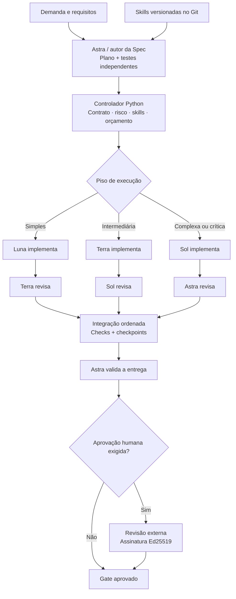
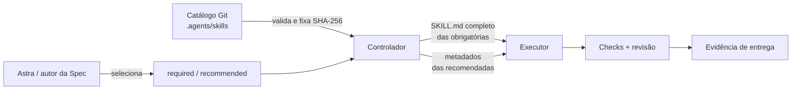

<div align="center">

# Codex Orchestrator

**Orquestração determinística de agentes de código, com execução multi-modelo, revisão independente e evidências verificáveis.**

Planeje com Astra. Execute com Luna, Terra ou Sol. Valide com critérios de aceite, checkpoints e gates reais.

<p>
  <a href="https://github.com/A1b3rt0M3rcad0/codex-orchestrator/actions/workflows/tests.yml">
    
  </a>
  
  
  
</p>

[Início rápido](#início-rápido) · [Arquitetura](#arquitetura) · [Skills por tarefa](#skills-por-tarefa) · [Qualidade e segurança](#qualidade-e-segurança) · [Comandos](#referência-de-comandos)

</div>

---

> [!IMPORTANT]
> **Status de validação:** a integração do controlador foi testada com processos, Git, worktrees, checks, persistência e assinaturas Ed25519 reais, usando um **Codex CLI simulado** para as chamadas aos modelos. O teste autenticado com os modelos reais e o benchmark de economia ainda precisam ser executados no ambiente consumidor. Uma CI verde não demonstra, por si só, qualidade dos modelos ou redução de custos.

## Visão geral

O **Codex Orchestrator** é um controlador local, desenvolvido em **Python 3.11+**, para organizar a implementação de software por modelos com diferentes capacidades sem transferir a coordenação para uma cadeia de conversas entre LLMs.

A **Spec e os testes de aceite são preparados antes da implementação**. O controlador roteia as tarefas, executa as verificações, solicita revisão independente, integra em uma ordem estável e emite um gate apenas quando a entrega satisfaz as exigências do plano.

| Capacidade | O que o projeto oferece |
|---|---|
| **Roteamento econômico** | Luna, Terra ou Sol executam conforme complexidade e piso de risco; Astra não é um intermediário para cada chamada. |
| **Revisão hierárquica** | Luna → Terra; Terra → Sol; Sol → Astra. O autor do patch não o aprova sozinho. |
| **Skills vinculadas** | Astra/autor da Spec seleciona skills por tarefa; o controlador valida e entrega instruções obrigatórias ao executor. |
| **Qualidade executável** | Contratos de aceite prévios, baseline, mutation testing, checks reais e checkpoints. |
| **Integração isolada** | Worktrees por tarefa, escrita controlada, dependências explícitas e integração determinística. |
| **Evidências auditáveis** | Respostas, logs, snapshots, hashes de arquivos, consumo e referências de revisão. |
| **Controle operacional** | Limites de tentativas, chamadas e consumo observado, com retomada persistente. |

**Princípio central:** o controlador toma decisões mecânicas; modelos implementam, inspecionam e avaliam. Não há aprovação implícita por resposta textual nem fallback silencioso de modelo.

## Arquitetura



*A classificação pode elevar a tarefa inicialmente atribuída a Luna ou Terra. Mudanças críticas também exigem verificações adversariais e sondas de mutação antes da aprovação.*

### Papéis e responsabilidades

| Papel | Implementação | Revisão | Identificador padrão |
|---|---|---|---|
| **Luna** | Tarefas simples | — | `gpt-6-luna` |
| **Terra** | Tarefas intermediárias ou escaladas | Luna | `gpt-6.1-terra` |
| **Sol** | Tarefas complexas ou críticas | Terra | `gpt-6.1-sol` |
| **Astra** | Planejamento externo, validação de contrato e entrega global | Sol | `gpt-6-astra` |

Esses IDs são **configurações declaradas pelo projeto**, não uma confirmação de que os modelos estão disponíveis na sua conta. O comando `smoke-models` testa o acesso real mediante autorização explícita.

### Fluxo de execução

1. **Planejamento:** Astra ou o autor da Spec define tarefas, escopos, dependências, critérios de aceite, checks e skills.
2. **Preflight:** o controlador verifica o plano, sela os testes e configurações relevantes, executa o baseline e submete o contrato de testes à revisão de Astra.
3. **Implementação:** o executor designado trabalha em sua própria Git worktree; risco e orçamento são reavaliados durante a execução.
4. **Verificação local:** checks, mutações previstas e revisão independente; falhas retornam ao executor dentro dos limites de tentativas.
5. **Integração:** patches aprovados são integrados na ordem do plano; mudanças de base exigem nova verificação e revisão.
6. **Validação final:** checks globais e Astra verificam o conjunto; alterações sujeitas a gate humano exigem assinatura externa.

O runtime não cria planos automaticamente a partir de texto livre. Essa responsabilidade permanece na **skill do Orchestrator e no planejador externo**.

## Início rápido

### 1. Instale

**Requisitos:** Linux, macOS ou WSL; Python **3.11+**; Git; Codex CLI instalado e autenticado. OpenSSL 3+ com Ed25519 é necessário para aprovações humanas assinadas. Windows nativo não foi validado para os hooks.

```bash
python3 -m venv ~/.venvs/codex-orchestrator
source ~/.venvs/codex-orchestrator/bin/activate

python -m pip install \
  "git+https://github.com/A1b3rt0M3rcad0/codex-orchestrator.git"

codex-orchestrator --repo /caminho/do/projeto install
```

O instalador preserva o projeto existente e adiciona, quando necessário:

```text
.agents/skills/codex-orchestrator/
  SKILL.md
  references/workflow.md

.codex/
  config.toml
  hooks.json

AGENTS.md
orchestrator.toml
```

Ele não executa modelos, não instala dependências do projeto consumidor e não concede confiança aos hooks automaticamente. **Na sessão Codex, abra `/hooks`, revise e autorize os handlers**.

### 2. Configure checks reais

Edite o `orchestrator.toml` gerado. O exemplo abaixo ilustra uma configuração mínima para um projeto Python com testes executáveis:

```toml
version = 2

[runtime]
command = ["codex"]
parallel_workers = 1
checkpoint_every = 2

[budgets]
mode = "observed"
run_tokens = 2000000
task_tokens = 500000
call_tokens = 100000
task_calls = 24

[policy]
minimum_tier = "luna"
extra_patterns = []

[verification]
require_human = "critical"
mutation_policy = "critical"
trusted_signers = ""
protected_paths = []

[checks]
unit = ["{python}", "-m", "unittest", "discover", "-s", "tests", "-v"]
```

**Adapte os checks ao seu projeto.** É obrigatório configurar ao menos um comando real. O controlador não inventa testes nem aceita comandos fictícios que sempre passam. `{python}` utiliza o interpretador do controlador, e cada check é uma lista de argumentos sem shell implícito.

Para aplicações maiores, configure checks de integração, smoke, E2E e cenários adversariais e faça referência a eles no plano.

### 3. Descubra skills e prepare a Spec

```bash
codex-orchestrator --repo /caminho/do/projeto skills
```

Astra ou o autor da Spec define a seleção de skills, os testes independentes, os critérios de aceite e o plano JSON **v2**.

Um exemplo completo, pronto para servir de referência estrutural, está em [`examples/demo.plan.json`](examples/demo.plan.json). Os testes correspondentes estão em [`examples/demo_project/`](examples/demo_project/).

### 4. Valide e execute

Depois de configurar os checks e **fazer commit do código-base, da configuração e dos testes de aceite**, execute:

```bash
cd /caminho/do/projeto

codex-orchestrator doctor
codex-orchestrator validate plano.json

# Opcional: verifica acesso real aos modelos; pode consumir sua conta.
codex-orchestrator smoke-models --acknowledge-paid-requests

codex-orchestrator run plano.json
codex-orchestrator status RUN_ID
codex-orchestrator gate RUN_ID
```

Você também pode invocar a skill na sessão configurada do Codex:

```text
$codex-orchestrator
Implemente a Spec deste projeto respeitando as skills, os testes
independentes, a política de risco e todos os gates obrigatórios.
```

O controlador produz uma branch própria (`orchestrator/RUN_ID`), sem fazer push ou merge automático no projeto consumidor. Um `gate` aprovado só é válido para o **snapshot exato** que foi verificado.

## Skills por tarefa

O Orchestrator possui **seleção explícita e auditável de skills**, mas mantém a liberdade do Codex de consultar materiais complementares quando necessário.



### Contrato de seleção

Adicione opcionalmente este objeto **dentro de uma tarefa** do plano v2:

```json
{
  "skills": {
    "required": ["domain-modeling", "tdd"],
    "recommended": ["codebase-design", "diagnosing-bugs"]
  }
}
```

As listas são obrigatórias quando o objeto `skills` está presente. Os nomes devem corresponder ao campo `name` do frontmatter de skills **versionadas no Git** em `.agents/skills/<diretório>/SKILL.md`. Não são aceitos nomes desconhecidos, duplicados ou a própria skill controladora `codex-orchestrator`.

| Tipo | Tratamento durante a implementação |
|---|---|
| **`required`** | Conteúdo integral do `SKILL.md` incluído na requisição do executor; até **40 KiB por chamada** somando as obrigatórias. |
| **`recommended`** | Nome, descrição, caminho e hash; o executor pode consultar a skill sob demanda. |
| **Revisão** | O revisor recebe referências das skills, sem duplicação automática do conteúdo completo. |

O catálogo é fixado por hashes SHA-256; as requisições vinculadas ficam registradas e são verificadas no gate. Em delegações, skills obrigatórias do pai são preservadas; filhos não podem introduzir skills não aprovadas no plano.

**O que é comprovado:** o conteúdo obrigatório foi entregue ao processo Codex. **O que não é comprovado automaticamente:** que o modelo aplicou corretamente as instruções, executou scripts auxiliares ou seguiu todas as recomendações. Isso exige critérios de aceite e revisão.

A vinculação auditável contempla, nesta versão, skills **locais do projeto e commitadas**; skills globais do usuário ou provenientes de plugins não fazem parte desse catálogo.

## Plano e contrato de testes

Cada tarefa declara seu escopo de escrita (`scope`), dependências de leitura (`reads`), critérios de aceite, checks e dependências de outras tarefas. Os testes principais precisam existir **antes da implementação** e permanecer fora dos escopos graváveis pelos executores.

Exemplo abreviado de uma tarefa válida, no contexto de um plano v2:

```json
{
  "id": "TEXT-1",
  "tier": "luna",
  "objective": "Implementar normalize_label conforme o contrato",
  "scope": ["textutil.py"],
  "reads": [],
  "acceptance": ["Espaços redundantes são normalizados"],
  "checks": ["unit"],
  "depends_on": [],
  "risk_tags": [],
  "test_contract": {
    "files": ["tests/test_textutil.py"],
    "cases": [
      {
        "criterion": "Espaços redundantes são normalizados",
        "check": "unit",
        "baseline": "fail",
        "rationale": "O comportamento ainda não existe no commit-base"
      }
    ]
  },
  "adversarial_checks": []
}
```

O contrato completo contém também `version`, `objective`, `acceptance`, `integration_checks`, `checkpoint_checks` e `tasks`. Consulte o [exemplo do repositório](examples/demo.plan.json) antes de adaptar.

**Baseline:** os testes devem indicar antecipadamente se cada check precisa passar ou falhar no commit inicial, com justificativa. A falha esperada precisa representar um contraexemplo conhecido — não um erro de importação, runner ou serviço indisponível.

### Mutation testing

Para tarefas críticas, a política padrão exige sondas de mutação pré-aprovadas. A opção recomendada, `file_replacement`, injeta um contraexemplo **independente da expressão textual que o modelo escolheu implementar**:

```json
{
  "mutations": [
    {
      "strategy": "file_replacement",
      "file": "textutil.py",
      "content": "def normalize_label(value):\n    return value\n",
      "check": "unit",
      "failure_marker": "AssertionError"
    }
  ]
}
```

O controlador aplica a mutação em uma **worktree descartável**, exige uma falha com marcador esperado e registra a evidência. Mutante sobrevivente, timeout ou falha pelo motivo errado bloqueia o fluxo.

A estratégia legada `exact_replace` continua disponível (`find` e `replace` com ocorrência textual única). A configuração `mutation_policy` aceita `"critical"` (padrão), `"all"` e `"optional"`.

## Qualidade e segurança

### Controles executáveis

| Controle | Garantia operacional |
|---|---|
| **01 · Classificação de risco** | Indícios lexicais elevam ao menos a Terra; mudanças materiais sensíveis, tags críticas e políticas explícitas exigem Sol e verificações reforçadas. |
| **02 · Oráculo independente** | Testes de aceite anteriores ao patch, baseline validado e arquivos de runner/configuração protegidos por hash. |
| **03 · Checkpoints** | Verificações intermediárias por lote, após tarefas críticas e antes de liberar dependentes. |
| **04 · Isolamento Git** | Worktree por tarefa, conflitos de acesso serializados e revalidação após mudança de base. |
| **05 · Escalonamento controlado** | Handoff factual com falhas, patch e evidências; sem transmitir transcrições privadas. |
| **06 · Orçamentos** | Reservas atômicas, limites de tentativas/chamadas/tokens e controle de consumo observado, inclusive em filhos e reparos. |
| **07 · Revisão independente** | Revisores sem narrativa do executor; etapas críticas exigem checks adversariais e assinatura humana externa. |
| **08 · Evidência reutilizável** | Cápsulas vinculadas à Spec, ao snapshot, ao modelo e aos logs; revisão só é reutilizada enquanto válida. |

### Classificação de risco

O controlador considera objetivo, nomes de caminhos, tags declaradas, alterações materiais no diff e padrões configurados em `policy.extra_patterns`.

- **Indício lexical:** piso **Terra**, sem assinatura humana automática.
- **Mudança efetiva em código sensível**, tag crítica, regra explícita do projeto ou conteúdo opaco: piso **Sol**, revisão por Astra, checks adversariais, mutação e aprovação humana.
- **Documentação e comentários apenas:** não se tornam críticos somente pelo nome, embora regras explícitas possam continuar exigindo revisão elevada.

As heurísticas não substituem análise semântica. Use `extra_patterns` para arquivos críticos do seu domínio.

### Testes e dependências protegidos

O controlador sela testes principais, convenções comuns de arquivos de teste, lockfiles, manifestos, runners e scripts de checks. Dependências não reconhecidas podem ser incluídas manualmente:

```toml
[verification]
protected_paths = ["checks/support/", "fixtures/contract.json"]
```

Os caminhos devem existir e estar commitados. A introdução ou alteração de arquivos protegidos depois da selagem bloqueia a execução. Os checks devem ser **não mutantes** sobre o checkout; use formatadores em modo verificação.

### Paralelismo e integração

`parallel_workers = 1` é o padrão. Até 16 workers podem ser configurados para tarefas independentes, desde que suas declarações de leitura/escrita não entrem em conflito. Tarefas críticas executam isoladamente, e o merge interno segue a ordem do plano.

Worktrees isolam o **código**, não portas, bancos, credenciais nem serviços externos. Os checks de tarefas paralelas precisam isolar esses recursos por conta própria.

## Orçamento e consumo

O controlador reserva uma franquia **antes** de iniciar cada chamada e contabiliza consumo por execução, tarefa, subárvore e papel. Limites monetários opcionais (`run_cost_usd` e `task_cost_usd`) exigem tarifas explícitas para os quatro papéis, definidas em `[prices.astra]`, `[prices.sol]`, `[prices.terra]` e `[prices.luna]`, com `input`, `cached_input` e `output` por milhão de tokens.

| Modo | Comportamento real |
|---|---|
| `observed` | Admissão local, reservas e cancelamento a partir de telemetria disponível; **não garante** teto absoluto de faturamento. |
| `strict` | Recusa novas inferências, pois o adaptador `codex exec` não comprova uma quota financeira transacional do provedor. |

A requisição pode ser cobrada remotamente antes de a telemetria chegar. Uso desconhecido retém a reserva e impede chamadas adicionais; `resume` não zera os limites. O projeto não embute tarifas comerciais nem deduz custos de uma assinatura Codex a partir dos tokens.

Para investigar economia, use os dados reais do comando [benchmark](#benchmarks-e-validação), nunca uma porcentagem presumida.

## Aprovação humana assinada

Alterações críticas requerem revisão adversarial e uma **assinatura Ed25519 externa**. O controlador nunca gera nem utiliza a chave privada do revisor.

1. Configure `verification.trusted_signers` apontando para uma allowlist JSON **fora do repositório**, contendo identidades e **chaves públicas** autorizadas.
2. Quando a execução entrar em `awaiting_human`, gere a declaração canônica:

   ```bash
   codex-orchestrator approval-request RUN_ID > approval.json
   ```

3. Após uma revisão humana independente, **no ambiente do signatário**, assine a declaração:

   ```bash
   openssl pkeyutl -sign -rawin \
     -inkey /local/privado/revisor.pem \
     -in approval.json -out approval.sig
   ```

4. Envie somente a assinatura ao ambiente do controlador e valide:

   ```bash
   codex-orchestrator approve RUN_ID \
     --statement approval.json \
     --signature approval.sig \
     --identity revisor@empresa
   codex-orchestrator gate RUN_ID
   ```

A declaração vincula a aprovação à execução, Spec, configuração, snapshot e evidências. Alterar o conteúdo exige nova verificação. A assinatura comprova posse da chave, não a qualidade intelectual da revisão realizada.

## Referência de comandos

| Comando | Finalidade |
|---|---|
| `install` | Instala a skill, configura o perfil/hook e preserva arquivos existentes. |
| `doctor` | Verifica pré-requisitos locais e compatibilidade de flags do CLI. |
| `skills` | Lista skills locais versionadas e seus hashes. |
| `validate PLANO.json` | Valida Spec, seleção de skills e configuração **sem executar modelos**. |
| `run PLANO.json` | Inicia uma nova execução a partir do estado commitado. |
| `list` | Lista execuções persistidas. |
| `status RUN_ID` | Consulta estado, tarefas, uso e vínculos de skills. |
| `resume RUN_ID` | Retoma a máquina de estados sem zerar limites. |
| `gate RUN_ID` | Confirma uma entrega aprovada para o snapshot atual. |
| `approval-request RUN_ID` | Emite o payload para revisão e assinatura externa. |
| `approve RUN_ID ...` | Verifica a assinatura humana de uma entrega pendente. |
| `smoke-models --acknowledge-paid-requests` | Testa acesso real aos modelos, sob autorização explícita. |
| `benchmark RUN_IDS...` | Compara execuções com mesmo plano e commit-base. |
| `migrate-config` | Migra explicitamente a configuração legada v1 para v2. |

A opção global `--repo /caminho/projeto` deve aparecer **antes** do subcomando quando o diretório corrente não for o repositório consumidor.

## Benchmarks e validação

A suíte automatizada executa o controlador real com um backend simulado em `tests/fake_codex.py`. Para reproduzir localmente:

```bash
python -m pip install --no-deps .
python -m unittest discover -s tests -v
python -m compileall -q codex_orchestrator
```

A CI cobre **Python 3.11, 3.12 e 3.13**. Para verificar autenticação, modelos e saída estruturada com a sua conta:

```bash
codex-orchestrator --repo /caminho/projeto \
  smoke-models --acknowledge-paid-requests
```

Esse smoke testa **acesso**, não qualidade de implementação nem fluxo E2E. Depois execute o projeto em [`examples/demo_project`](examples/demo_project/) com modelos reais para validar o fluxo completo.

Para comparar execuções com **o mesmo plano e commit-base**:

```bash
codex-orchestrator --repo /caminho/projeto \
  benchmark RUN_ID_1 RUN_ID_2
```

O relatório apresenta gates aprovados, intervalos estatísticos, chamadas, tokens e custos reportados, separando implementação de verificação. Para uma comparação com Sol executando diretamente, forneça um arquivo externo de baseline:

```bash
codex-orchestrator --repo /caminho/projeto \
  benchmark RUN_ID_1 RUN_ID_2 --direct-baseline direct-sol.json
```

O baseline externo deve conter tentativas medidas, evidências, o mesmo commit-base e hash de plano. O controlador valida seu formato, **não autentica automaticamente os resultados externos**. Consulte [Q2 — Qualidade, consumo e verificação](docs/Q2-VERIFICATION.md).

## Estado, recuperação e migração

Os artefatos ficam fora do código de aplicação, em:

```text
GIT_COMMON_DIR/
  codex-orchestrator/
    runs/RUN_ID/
      plan.json
      state.json
      calls/
      checks/
      patches/
      capsules/
      ...
```

Incluem logs, requests e respostas que podem conter código sensível; trate o armazenamento como privado. Branches de tarefa e integração ficam em worktrees isoladas. Retomadas verificam hashes e snapshots, sem reiniciar orçamento ou tentativas. Evidência obsoleta bloqueia o gate.

**Atualização de projetos legados:**

```bash
python -m pip install --upgrade \
  "git+https://github.com/A1b3rt0M3rcad0/codex-orchestrator.git"

codex-orchestrator install
codex-orchestrator migrate-config
```

`migrate-config` preserva uma cópia `orchestrator.toml.v1.bak` e converte a configuração em uma operação explícita. **Planos e execuções v1 não são migrados por inferência**; prepare um plano v2 e os testes independentes correspondentes.

## Limites e responsabilidades

- **Não é um serviço remoto ou MCP server:** é uma aplicação CLI local de orquestração e auditoria.
- **Não faz deploy, push ou merge automático** no repositório consumidor. A integração final segue o workflow do projeto.
- **Não gera Specs automaticamente a partir de texto livre:** o planejamento inicial permanece externo.
- **Não atesta cumprimento semântico de skills:** comprova o conteúdo enviado ao subprocesso, não o comportamento do modelo.
- **Não garante economia, ausência de bugs ou cobrança máxima do provedor.** Essas afirmações exigem evidência externa apropriada.
- **Não isola recursos do sistema operacional por completo:** os checks rodam sob o usuário local; worktrees não são sandboxes de segurança.
- **Não torna modelos da mesma família estatisticamente independentes** apenas por usar contextos distintos.

## Estrutura do projeto

```text
codex_orchestrator/
  cli.py          comandos e relatórios
  runtime.py      máquina de estados e integração
  model.py        transporte Codex CLI e estágios isolados
  contracts.py    Spec e validação estrita
  policy.py       classificação de risco e testes selados
  skills.py       catálogo, vínculos e evidência de entrega
  quality.py      mutation testing
  evidence.py     cápsulas, proveniência e assinatura
  budget.py       reservas e consumo
  benchmark.py    comparação de execução e custo
  smoke.py        teste opt-in de acesso aos modelos
  hooks.py        ciclo de vida e telemetria
  install.py      instalação e migração
  system.py       Git, processos, locks e filesystem
  assets/         skill e referência operacional

examples/         demonstração do plano e do projeto
tests/            suíte com backend Codex simulado
docs/             controles, metodologia e limites
```

### Documentação complementar

- [`docs/Q1-CONTROLS.md`](docs/Q1-CONTROLS.md) — controles de engenharia, concorrência e revisão.
- [`docs/Q2-VERIFICATION.md`](docs/Q2-VERIFICATION.md) — qualidade verificável, mutações, consumo e benchmarking.
- [`docs/VALIDATION.md`](docs/VALIDATION.md) — evidências e limites dos testes locais.
- [`codex_orchestrator/assets/WORKFLOW.md`](codex_orchestrator/assets/WORKFLOW.md) — contrato de execução e política detalhada.
- [`examples/demo.plan.json`](examples/demo.plan.json) — exemplo de plano v2 completo.

### Referências oficiais

- [Codex — modo não interativo](https://developers.openai.com/codex/noninteractive)
- [Codex — configuração](https://developers.openai.com/codex/config-reference)
- [Codex — hooks](https://developers.openai.com/codex/hooks)
- [Codex — skills](https://developers.openai.com/codex/skills)
- [OpenSSL — assinaturas Ed25519](https://docs.openssl.org/3.5/man1/openssl-pkeyutl/)

---

<div align="center">
  <sub>Codex Orchestrator é uma implementação independente. Não constitui um workflow oficial da OpenAI.</sub>
</div>
